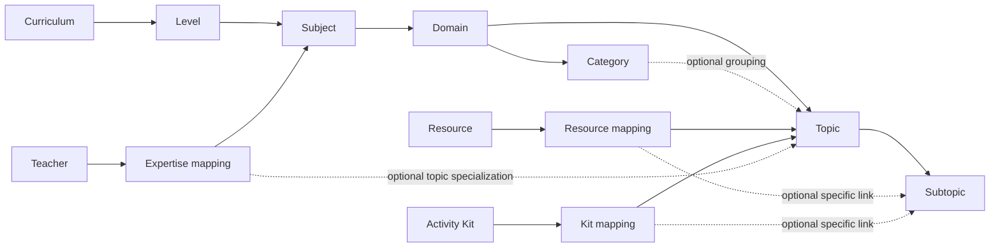
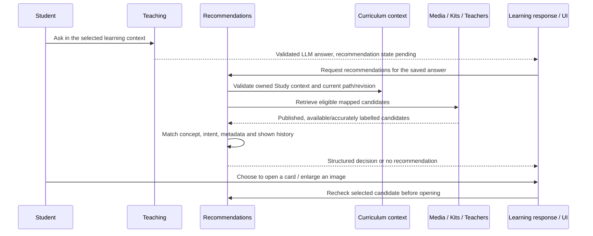

# FLAME curriculum, resources, kits and teachers: behaviour and relationships

Reviewed: 2026-10-07. This guide describes the current development implementation. Examples illustrate relationships; their names and abbreviated IDs are not importable data. Download the live Excel template for actual IDs.

## 1. The basic model

FLAME separates the learning hierarchy from the items that support learning:

| Object | Purpose | Main relationship |
| --- | --- | --- |
| Curriculum | Defines a learning programme and its published hierarchy | Contains Levels |
| Level | Represents a grade or another curriculum level | Belongs to one Curriculum |
| Subject | Represents a subject within that level | Belongs to one Level |
| Domain | Groups related subject content | Belongs to one Subject |
| Category | Optional grouping within a domain | Belongs to one Domain |
| Topic | Represents a concept/chapter | Belongs to one Domain; may also have a Category |
| Subtopic | Represents a specific part of a topic | Belongs to one Topic |
| Resource | Stores media and its descriptive, access and rights details | Links to one or more Topics/Subtopics, or remains unmapped |
| Activity Kit | Stores an activity guide, materials, images and supervision details | Links to one or more Topics/Subtopics |
| Teacher | Stores a tutor profile and declared/reviewed expertise | Links to Subjects and optionally Topics |
| Student | Stores an individual profile | Owns learning selections and conversations; does not own the catalogue |

The hierarchy is commonly displayed as:

```text
Curriculum → Level → Subject → Domain → Category → Topic → Subtopic
```

**Category is optional.** In the database, every Topic has a Domain ID. A categorized Topic also has a Category ID, and that Category must belong to the same Domain. A Topic can therefore exist directly under a Domain without a Category. Category remains part of administration/import context but is hidden in the current student My Learning hierarchy.

Illustrative full path:

```text
FlipLecture → Grade 1 → Science → Forces & Motion
            → Gravity activities → Gravity → Falling objects
```

Names can repeat in different branches. Grade 1 Science and Grade 2 Science have different Subject IDs, even though both are named Science.

## 2. Relationship diagram



Each catalogue item can have multiple mapping rows. Multiple catalogue items can link to the same Topic, Subtopic or Subject. These are **many-to-many relationships**, implemented through mapping tables rather than duplicated catalogue records.

There is currently no direct Teacher → Resource, Teacher → Kit or Kit → Resource-catalogue mapping. They meet through a shared curriculum context. A Kit owns uploaded images through the upload mechanism; that does not make those images separately mapped Resource Library records.

## 3. IDs, record keys, paths and labels

| Field | Meaning | Who supplies it? |
| --- | --- | --- |
| Curriculum/Level/Subject/Domain/Category/Topic/Subtopic ID | Identifies a particular hierarchy node | FLAME generates it |
| Resource/Teacher/Kit/Student ID | Identifies a saved catalogue item/profile | FLAME generates it |
| `existing_id` | References that saved item's ID during bulk import | Copy from FLAME export; blank for a new item |
| `record_key` | Stable import reference for an item; also joins its workbook mappings | Administrator assigns it; exports provide a reusable key |
| Path | The hierarchy leading to a Topic or Subtopic | Derived from saved hierarchy relationships |
| `label` in Paths | Readable full-path text, usually separated by `/` | Generated from hierarchy names |

Example label:

```text
FlipLecture / Grade 1 / Science / Forces & Motion / Gravity activities / Gravity / Falling objects
```

The label helps an administrator select the correct row. It is not an identifier and is not used to create or resolve a bulk mapping. Optional Category and absent Subtopic names are omitted, so labels do not always have seven segments.

Keep each item's `record_key` stable between imports. Different items should normally use different keys within a module. Repeating a key means the rows identify the same item and should be consolidated. In Mappings, repeating the key is expected when one item has multiple links. When both `existing_id` and a registered key are supplied, they must identify the same item.

## 4. What a mapping actually stores

### Resources and Kits

A mapping stores:

```text
item ID + topic_id + optional subtopic_id
```

The Topic supplies Curriculum, Level, Subject, Domain and optional Category through its ancestors. If a Subtopic is supplied, it must belong to that Topic. The server rejects missing, archived or mismatched hierarchy nodes when adding mappings.

### Teachers

An expertise mapping stores:

```text
teacher ID + subject_id + optional topic_id + claim status
```

A Subject-only link declares expertise for that particular Subject node. A Topic link specializes the expertise within that Subject. The server verifies that the Topic belongs to the specified Subject. Teachers currently do not have direct Subtopic expertise mappings.

**Scope matters:** mapping a teacher to Grade 1 Science does not map that teacher to Grade 2 Science, or to Science in another curriculum. Add additional expertise links for those distinct Subject IDs.

### Coverage examples

| Saved link | Topic conversation | Subtopic A conversation | Subtopic B conversation |
| --- | --- | --- | --- |
| Resource/Kit → Topic, no Subtopic | Eligible by mapping | Eligible by inherited topic coverage | Eligible by inherited topic coverage |
| Resource/Kit → Topic + Subtopic A | Not eligible through this link alone | Eligible by direct mapping | Not eligible through this link |
| Teacher → Subject, no Topic | Eligible when this is the selected Subject | Eligible within that Subject | Eligible within that Subject |
| Teacher → Subject + this Topic | Eligible for this Topic | Eligible within this Topic | Eligible within this Topic |

“Eligible by mapping” still requires publication, availability, access and recommendation checks. It does not mean the item will appear after every answer.

Topic-wide coverage is computed when querying. FLAME does not create a separate mapping row for every covered Subtopic. Adding a Subtopic to the same valid Topic makes it covered by the topic-wide link. A direct Subtopic link remains specific to its saved Subtopic ID.

An item may be mapped to several Topics, Subtopics or curricula. An ancestor's repeated name does not make it the same node: each mapping follows its actual IDs.

## 5. Curriculum administration and publication

The Curriculum Catalogue owns hierarchy creation, editing, Excel hierarchy import, drafts, publication, archive/restore and revision history.

The standard replacement workflow is:

```text
Upload curriculum workbook
→ map workbook sheets to Levels
→ validate and compare
→ confirm replacement into a private draft
→ review/edit saved hierarchy
→ publish explicitly
```

Sheet-to-Level mapping belongs to curriculum workbook import. It assigns a workbook sheet to a curriculum Level; it does not map a media resource to that Level.

- Uploading or previewing a workbook does not publish its rows.
- Applying a replacement updates the draft. The published hierarchy remains available until publication succeeds.
- Publication validates the hierarchy and records a published revision snapshot. Published Topics require valid Subtopics.
- Retained paths may preserve existing IDs. New or removed/restructured paths must be reviewed; names alone are not a promise that an old mapping remains valid.
- Archiving makes the curriculum/branch unavailable for new selection and current catalogue eligibility. It retains history rather than deleting every supporting item.
- Curriculum restore returns the curriculum to Draft in the current implementation. Review the hierarchy and publish explicitly to restore published availability.

### What happens to supporting items after hierarchy changes?

Resources, Kits and Teachers are separate records; replacing a curriculum does not create replacements for them automatically. Their existing links refer to saved node IDs.

If a mapped path becomes archived or unavailable, it cannot supply a new valid learning placement. Administrators should refresh mappings and use current IDs. A renamed label may still describe the same retained node; an unrelated node with the same name does not inherit an old link automatically.

Kit eligibility rechecks its publication requirements, including all saved paths. A stale/unpublished Kit path can therefore make the Kit unavailable as a recommendation until its mappings are corrected. Current teacher expertise and the selected Subject/Topic are also checked; profiles are not matched across unrelated subjects.

## 6. Resource Library behaviour

### Creation and mapping

```text
Add media and details → Save draft → Map topics / Manage mappings
                     → Preview → Publish explicitly
```

Resources support image, diagram, audio, video, animation, interactive and external-video types according to existing source/file validation. Media can be an uploaded file or an approved URL. External videos use supported YouTube/Vimeo URLs, not arbitrary iframe HTML. Animated GIFs use Animation and retain their original animated bytes.

- Creation can save a resource without mappings.
- The library shows an unmapped resource as Not mapped.
- The mapping dialog preselects existing links, supports multiple selections and preserves selections across its filters/pages.
- Save mappings replaces the saved association set atomically. Removing a link here is an explicit unmapping operation. Cancel leaves the saved set unchanged.
- Draft and Published resources can be mapped/unmapped. Saving mappings preserves publication status.
- Removing the last mapping leaves a Published resource Published but with no Topic/Subtopic learner placement.

### Publication requirements

Resource publication checks availability, rights basis/holder/distribution scope, applicable licence/permission references, accessibility details and a valid existing media source. Images/GIFs require an appropriate description; other relevant media require captions/transcript or an accessibility note. File storage/source validation remains enforced.

An unmapped resource can be published when its media requirements pass. Learner placement still requires a valid published curriculum mapping.

### Editing, unpublishing and deleting

- The current admin detail editor requires Unpublish before saving media/detail edits, then explicit publication after review. Metadata-only edits retain the file unless Replace file is selected.
- Unpublish removes learner visibility while retaining media, details and mappings.
- Delete requires confirmation and version checks. It removes the row from the normal library, removes associations, marks the resource deleted and stores a deletion snapshot.
- The current deletion policy retains media and historical/shared references. There is no admin restore action for a deleted Resource. It is not an immediate storage purge.

Resources use one current record and version, not independent draft/published media revisions. The backend PATCH API can revalidate changes to a Published resource; the current editor imposes the stricter unpublish-before-details-edit flow. Mapping-only changes remain supported while Published. Bulk import preserves Published resource details entirely.

### Filtering and delivery

Library hierarchy filters search saved associations across the catalogue. They do not alter mappings and do not operate only on the loaded page. A Subtopic filter includes topic-wide resources that cover that Subtopic. A Topic browsing filter can also show resources mapped directly to that Topic's Subtopics; a Topic-only learning conversation has the narrower coverage rule in section 4.

An item with multiple links appears once in the library result. Mapping names/counts describe its placement, not copies of its file.

Learner delivery rechecks current publication, availability, mapping eligibility and source/storage access. Stored media uses controlled delivery; external videos use the approved in-app viewer. Provider restrictions, country restrictions, network failure or disabled embedding can still prevent playback. The existing standard provider mode may retain provider links; this guide does not promise navigation-free third-party playback.

## 7. Activity Kit behaviour

A Kit contains a name, description, materials, instructions, supervision, image uploads, optional cost/currency, availability and optional supplier information. Cost is descriptive; it does not create checkout or a purchase.

- A new Kit is saved as a draft with at least one Topic/Subtopic path. The current create/edit schemas require a nonempty path list when supplied.
- Kit images are owned uploaded files, not Resource Library record IDs. Upload ownership/type checks apply.
- Publication requires a name, description, materials, instructions, supervision, image(s) present in storage, and valid published paths.
- Recommendation retrieval additionally requires the Kit's availability to normalize to Available. Unknown availability is not enough for automatic Kit recommendations.
- A Topic link covers that Topic and its Subtopics; a Subtopic link is specific.
- An ordinary edit replaces supplied paths/images/material lists. Bulk import instead adds paths/material values and preserves existing images.
- A successful edit of a Published Kit keeps it Published and revalidates publication requirements. It updates the current guide immediately; there is no separate private Kit revision awaiting publication.
- The current admin Kit screen uses a path picker in the editor. It does not have the Resource Library's independent Manage mappings dialog or a Kit delete workflow.

Students receive a relevant optional activity-guide card, including materials, instructions and supervision/prerequisite guidance. FLAME does not automatically launch an activity, confirm completion, order materials or calculate mastery from that card.

## 8. Teacher behaviour

A Teacher is a tutor catalogue profile containing name, bio, qualifications, experience, languages, availability and expertise links. It is not automatically an authenticated teacher account or an admin role.

- A draft profile can be saved before expertise is complete.
- Publication requires a valid name and at least one valid expertise link to a published subject/path.
- Expertise can be Declared or Reviewed in the normal admin workflow. Bulk imports add declared expertise and preserve existing reviewed claims.
- Normal edits replace a supplied expertise list. Bulk imports only add valid links.
- Published profiles can be edited; a successful save preserves publication and revalidates expertise. There is no independent published Teacher snapshot/draft revision.
- Known-unavailable tutors are excluded. Unknown/unconfirmed availability can be presented accurately; FLAME does not infer that such a tutor is currently online.
- The current Teacher admin screen has subject/topic expertise editing and Publish/Unpublish actions. It has no direct Subtopic mapping, independent Resource-style mapping dialog or teacher deletion workflow.

Tutor recommendations require explicit human-help intent, such as “I need a tutor.” Expertise, grade/language suitability and current eligibility still apply. A displayed profile does not contact the teacher, send a message or make a booking.

## 9. How a learning conversation uses these relationships



Teaching and recommendations remain separate modules and requests. The small learning-response composer provides compatible answer/recommendation envelopes; it does not add another teaching model call or make the answer wait for catalogue retrieval.

Study uses the selected curriculum path. Current recommendation retrieval requires a valid Subject/Topic context and matching curriculum revision. Curiosity has no curriculum catalogue context and currently does not use this mapped recommendation flow.

### Eligibility versus selection

1. **Mapping:** is the item linked to this exact learning context or its supported coverage?
2. **Eligibility:** is it published, usable, authorized and available under its module's rules?
3. **Suitability:** does its grade/language metadata fit where specified?
4. **Selection:** does it help explain this concept, demonstrate a process, support practice or provide explicitly requested human help?
5. **History:** has this ID/version already been shown or offered in this conversation?

| Learning need | Preferred support when a relevant candidate exists |
| --- | --- |
| Explain a concept | One relevant image/diagram inline |
| Show movement or a process | Optional video/animation card |
| Practise/test understanding | Optional Kit card |
| Request human help | Relevant tutor profile with accurate availability |
| Simple follow-up / insufficient match | Text alone, or a useful earlier-resource reference |

These are preferences, not guaranteed outputs. Topic association alone does not cause every mapped item to appear. Metadata supports ranking but does not bypass publication/access requirements or guarantee selection.

Selection returns one primary recommendation and at most one useful alternative. Videos, Kits and tutors remain student-controlled; there is no automatic playback, modal opening, activity launch or contact. Empty recommendation sections are hidden.

Displayed/offered candidate IDs and versions are tracked in conversation history. Follow-ups suppress unnecessary repeats or offer a reference to the earlier item. Explicit show/repeat requests can override suppression. Reopening preserves that history. Previous answer decisions are not silently reranked; an unavailable or changed-version item may be omitted or fail an open-time recheck while the explanation remains readable.

### Recommendation metadata

Resources, Teachers and Kits have optional concepts, synonyms, grade minimum/maximum, teaching-language codes and teaching purposes. Administrators enter/review these fields. Technical file details such as MIME type and size are derived from upload inspection; teaching metadata is not automatically generated.

Current grade matching derives the grade from the selected Level name when it recognizes a Grade/Class/Level number or KG. A free-form Level name may leave the grade unknown; entering resource metadata alone does not supply a missing student grade.

Metadata can explain that a push/pull illustration supports Force, while a falling-object video supports Gravity. Mapping both to one chapter supplies both as candidates; the current question/answer and intent determine which, if either, is selected.

## 10. Versions, publication and history

| Value | What it controls |
| --- | --- |
| Curriculum version | Optimistic concurrency for curriculum changes |
| Published curriculum revision | The published hierarchy/snapshot and learning context |
| Draft revision | Saved private hierarchy changes awaiting publication |
| Curriculum import preview token/revision | The particular replacement comparison being confirmed |
| Resource/Teacher/Kit version | Current item changes, concurrency and recommendation history matching |
| Bulk preview token | The exact additive comparison being confirmed |

These values are distinct. Resource version 2 does not mean curriculum revision 2. Saving a mapping does not publish a new curriculum revision. Publishing a curriculum does not automatically publish its linked resources, teachers or Kits.

Study conversations retain their selected context/revision. New questions revalidate that context. A changed published curriculum revision or archived ancestry can require a new selection/session; old text remains history. Current media/profile access is checked even when opening an earlier conversation.

A stale mutation must be reviewed against the latest server state. It is not automatically safe to retry with a new version number, because mappings or details may have changed elsewhere.

## 11. Excel import/export relationships

### Workbook sheets

| Sheet | Purpose | Does it write relationships? |
| --- | --- | --- |
| Records | Media, Teacher, Student or Kit data | Creates/merges catalogue records when confirmed |
| Mappings | Joins a record key to hierarchy IDs | Adds valid links on confirmed bulk import |
| Paths | Reference list of current Topic/Subtopic/Subject IDs and readable labels | No; not an import instruction sheet |
| Guide | Instructions | No |

Students have profile fields and no curriculum Mappings/Paths sheets in their templates. Students' My Learning memberships are separate from Resource/Kit/Teacher mappings. Importing a student does not enrol that student into a curriculum.

The current **Mappings** columns are `record_key`, `topic_id`, `subtopic_id`, `subject_id`. Resources/Kits use Topic and optional Subtopic; Teachers use Subject and optional Topic. The current Paths sheet exposes `topic_id`, `subtopic_id`, `subject_id`, `label`.

**Current usability gap:** separate readable Curriculum, Level, Subject, Domain, Category, Topic and Subtopic columns are not yet implemented in the bulk mapping template. The label displays the path, but the importer currently resolves mappings by IDs. Describing those seven readable columns as an improvement does not mean they already work.

### Small example

Records:

| record_key | existing_id | title |
| --- | --- | --- |
| gravity-video-001 | blank for new item | Gravity demonstration |

Mappings:

| record_key | topic_id | subtopic_id | subject_id |
| --- | --- | --- | --- |
| gravity-video-001 | actual Gravity Topic ID | blank | blank |
| gravity-video-001 | another actual Topic ID | actual Subtopic ID belonging to that Topic | blank |

Both mappings belong to one resource. IDs above are explanatory text; copy real values from the live template. A Mappings key absent from Records is rejected.

### Bulk merge versus ordinary editing

Bulk import preserves existing nonempty scalar values, existing media, availability and publication state. It can fill eligible missing details and add languages/materials/teaching metadata and valid mappings within their limits. Existing grade ranges and reviewed expertise are preserved. Published Resource details remain unchanged.

Repeated keys/items consolidate; ambiguous matches require an exported `existing_id`. Commit is atomic. Invalid rows block the workbook. Changed data after preview requires Review latest comparison and renewed confirmation; staged files are retained for that recovery. Completed-request replay returns its receipt rather than creating the items again.

**Bulk import adds mappings. Ordinary mapping/edit dialogs can replace a supplied association set.** Use the explicit normal editor/dialog to remove an association; leaving it out of a bulk workbook does not unmap it.

Export returns the module catalogue rather than just the visible page/filter. Excel includes metadata, keys/IDs and mappings. Resources/Kits can export original stored media in ZIPs. External videos remain URLs. Import does not automatically publish records or create passwords, invitations, admin roles or curriculum memberships.

New Students become pending profiles. A matching confirmed email and independently verified provider identity are required to activate/claim the profile on sign-in. Existing identities and status are preserved; inactive/removed profiles cannot be reactivated by bulk import.

For limits, ZIP folder structure, samples and cleanup/expiry rules, read [Bulk import samples and instructions](bulk-import-samples/README.md) and [B13 handoff](backend/stage-13-bulk-transfer.md).

## 12. Practical examples and diagnosis

### One resource, several learning placements

An administrator uploads one Gravity image and maps it to a Gravity Topic in one curriculum and a Motion Subtopic in another. There is one Resource ID/file and two mapping rows. Removing one mapping preserves the other placement and the resource. Publishing one curriculum does not publish the image; the resource's own Publish action is still required.

### Topic-wide resource and specific resource together

A general Gravity diagram is mapped to the Topic. A falling-ball video is mapped only to Falling objects. A Topic conversation can consider the diagram through that topic-wide link. A Falling objects conversation can consider both, then rank by the actual question. A different Subtopic does not inherit the specific video link.

### Teacher and Kit alongside the explanation

A teacher has Grade 1 Science expertise and a Kit is mapped to Gravity. “Explain gravity” may show a relevant diagram, “Test my understanding” may offer the Kit, and “I need a tutor” may offer the teacher. Neither mapping forces all three to appear together.

### Why an item does not appear

Check, in order:

1. Is the relevant curriculum/path published and current for the conversation?
2. Is the item published, not deleted, and available under its module's rules?
3. Does a valid saved mapping cover this exact Topic/Subtopic or teacher Subject/Topic?
4. Does the source/file exist and permit usable playback/delivery?
5. Do specified grade/language metadata fit?
6. Does the item help the current concept/intent, rather than just the chapter generally?
7. Has the same ID/version already been offered/shown, or is an earlier reference more appropriate?

No recommendation can be the correct result. An old stored conversation can retain its text while a previously selected supporting item is no longer accessible at its saved version.

## 13. Source map and current boundaries

| Concern | Implementation source |
| --- | --- |
| Hierarchy and revisions | [Curriculum models](../development/apps/flame-api/app/modules/curriculum/models.py), [draft/publication service](../development/apps/flame-api/app/modules/curriculum/drafts.py) |
| Path ancestry validation | [Curriculum public paths](../development/apps/flame-api/app/modules/curriculum/public_paths.py) |
| Resource mappings/publication/deletion | [Resource router](../development/apps/flame-api/app/modules/resources/router.py), [resource service](../development/apps/flame-api/app/modules/resources/service.py) |
| Media access/delivery | [Member resource router](../development/apps/flame-api/app/modules/resources/member_router.py), [media candidates](../development/apps/flame-api/app/modules/resources/candidates.py) |
| Teacher expertise and eligibility | [Teacher router](../development/apps/flame-api/app/modules/teachers/router.py), [teacher candidates](../development/apps/flame-api/app/modules/teachers/candidates.py) |
| Kit guide requirements and eligibility | [Kit router](../development/apps/flame-api/app/modules/activity_kits/router.py), [Kit publication rules](../development/apps/flame-api/app/modules/activity_kits/service.py), [Kit candidates](../development/apps/flame-api/app/modules/activity_kits/candidates.py) |
| Selection/history/composition | [Recommendation service](../development/apps/flame-api/app/modules/recommendations/service.py), [selection](../development/apps/flame-api/app/modules/recommendations/selection.py), [composer](../development/apps/flame-api/app/modules/learning_response/composer.py) |
| Workbook contracts and additive merging | [Bulk workbooks](../development/apps/flame-api/app/modules/bulk_transfer/workbooks.py), [bulk service](../development/apps/flame-api/app/modules/bulk_transfer/service.py), [bulk router](../development/apps/flame-api/app/modules/bulk_transfer/router.py) |

Supporting records are currently separate modules inside one backend application/database. This guide does not imply microservices, tutor booking, commerce, automatic content approval, mastery tracking or independent published revisions for every catalogue type.

The full readable hierarchy columns in bulk Mappings, richer Teacher/Kit management/deletion, separate catalogue draft snapshots, production-scale asynchronous bulk work and operational acceptance remain improvements rather than behaviours implemented by this documentation. Educator/content quality and release gates remain in the canonical [tracker](STAGES-STEPS.md).
