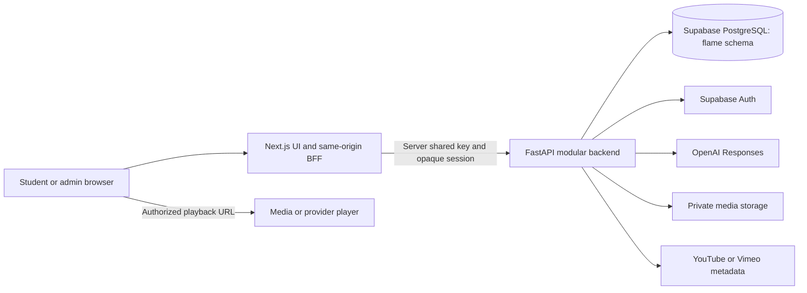

# FLAME development handoff

Documentation reconciled: **9 October 2026, Asia/Calcutta**. Original environment inspection: 7 October; its dated evidence below remains historical. Workspace: `E:\FLAME`; Windows PowerShell.

This is a technical orientation and dated handoff snapshot. [STAGES-STEPS.md](STAGES-STEPS.md) remains the **only active progress tracker**. This document does not close stages or authorize deployment. Current code and later owner decisions take precedence over historical planning examples.

## Interactive HTML5 follow-up — 9 October 2026

Interactive-only development now supports self-contained HTML/HTM uploads using existing private resource storage, PostgreSQL metadata/mappings and authorized JSON delivery into a sandboxed Next.js viewer. Image/Video implementation and provider rules are unchanged; no schema migration. The real Gravity Lab — Interactive is saved as an available unpublished draft v2 with one Grade 1 Gravity topic link and eight subtopic links; stored admin preview completes a 10 m fall. Current local frontend upstream is the reload API on 127.0.0.1:8001, superseding this document's earlier port-8000 runtime snapshot. Read the [Interactive stage handoff](backend/stage-9-interactive-html5.md) for build flow, source ownership, reproducible checks, live record, remaining publication/learner/cloud/device/educator acceptance and reversal. Exact statuses/evidence remain only in STAGES-STEPS.md.

## B11 module update — 7 October 2026 (historical snapshot)

Recommendation orchestration/persistence now lives in `app/modules/recommendations/`, with typed catalogue services owned by Media (`resources/`), Teachers and Activity Kits. A small `learning_response/` composer adds compatible response envelopes while retaining separate answer/selection requests. No extra LLM request, database migration or deployment. See [B11 technical handoff](backend/stage-11-modular-migration.md) and the tracker for current verification; the initial snapshot below describes the pre-migration layout.

Interactive viewer follow-up: top-right fullscreen/restore now preserves the running experiment, uses an upright wide canvas with horizontal scrolling in portrait; orientation lock and CSS rotation were removed at owner direction. Build/typecheck and expanded fixture-browser checks passed; physical-phone fullscreen/manual-rotation acceptance remains open. See the Interactive handoff for cleanup, keyboard and browser limitations.

Browse Media follow-up: thumbnail click/keyboard opening and YouTube/private uploaded-video thumbnails are implemented. Resource Library manages video thumbnail images; MP4/WebM publication requires one. Migration `20261009_28` applied, drift clean. [Thumbnail handoff](backend/stage-9-video-thumbnails.md) records contracts, validation and verification.

## Later development carried into this handoff — 7–9 October 2026

B12 adds optional manually reviewed concepts, alternative terms, grade/language and teaching-purpose metadata, measured ranking/evaluation and tutor-query improvements. B13 adds owner-scoped preview, atomic additive import/export and sample packages for Media, Teachers, Students and Kits; imported students remain pending profiles without automatic accounts, role grants or invitations. F10/B14 adds independent published-path Explore browsing and scoped item access without changing Study context or writing recommendation history. See [B12](backend/stage-12-recommendation-quality.md), [B13](backend/stage-13-bulk-transfer.md) and [F10/B14](backend/stage-14-learner-explore.md).

The October 8 media-family migration normalizes diagrams to Image and GIF/animations/provider videos to Video; Interactive is the third active family. Historical Audio is retained but unavailable for active creation/browsing. Later learner refinements include Study navigation following, Curiosity results across matching paths, retained Explore results/page/scroll and keyboard/pointer desktop pane resizing. Dated browser/build evidence and limitations are in the tracker; these updates do not close release gates.

## 1. Current development position

FLAME has two working applications: a Next.js student/admin frontend and a FastAPI modular backend. Supabase supplies PostgreSQL and authentication. The backend generates text explanations through the OpenAI Responses API and serves eligible curriculum-linked media, activity guides and tutor profiles.

Development flows include authentication, curriculum drafts/import/publication, My Learning, owned conversations and pins, measured activity, resource creation/mapping/publication/deletion, GIF playback, external videos and context-aware Study recommendations. Production readiness is not complete: B5 lifecycle operations, B7 live failure/continuation acceptance, B8 educator evaluation, B9 live-storage acceptance and B10 release work remain open in the tracker.

### Evidence from this review

| Check on 7 October | Result and boundary |
| --- | --- |
| Manifests, modules, routes, migrations and test entry points | Reviewed against the current tracker and implementation reports. |
| Installed runtimes | Node `v22.16.0`; backend virtual environment Python `3.13.2`. |
| Migration code head at original review | `20261003_24`. Current source head is `20261009_28` (private video thumbnails), following `20261008_27`, media families, after metadata `_25` and bulk transfer `_26`; later handoffs record application. No fresh database/drift audit in this documentation review. |
| Connected database version | `flame.alembic_version` reports `20261003_24`; inspected in a read-only transaction. This is not a fresh migration-drift audit. |
| Effective storage setting | `local`; production private-bucket acceptance is outstanding. |
| Effective LLM configuration | `gpt-6-luna`, maximum output 1,500 tokens, 100 requests/member/day; no secret values printed. |
| Local endpoint checks | `/health/live`, `/health/ready` and frontend `/api/auth/csrf` returned HTTP 200. |
| Tests/builds during this review | Not rerun for this documentation task. Dated prior results are linked below. |

## 2. Folder structure and document ownership

```text
E:\FLAME\
├── development\apps\
│   ├── web\                    Next.js application
│   │   ├── src\app\            Pages, BFF routes, shared styles
│   │   ├── src\features\       Student/admin feature components
│   │   ├── src\components\ui\  Shared controls and media players
│   │   ├── src\lib\api\        API clients and server BFF helpers
│   │   ├── public\             Brand and reviewed learning assets
│   │   ├── tests\              Node unit and browser scripts
│   │   └── .env.local           Private frontend-server configuration
│   └── flame-api\              FastAPI application
│       ├── app\core\           Settings, database, errors and logging
│       ├── app\modules\        Domain services, models and routers
│       ├── migrations\         Alembic environment/versioned changes
│       ├── scripts\            Maintenance, bootstrap, evaluation
│       ├── tests\              Unit/database integration tests
│       ├── .private-resources\ Default private local media directory
│       └── .env                 Private backend configuration
├── project-stages\             Canonical context/specifications/tracker
├── Planning\                   Scope and broader/future architecture
│   ├── flame_docs\             Relocated architecture/product documents
│   ├── tech-diagram\           Proposed target-stack diagram
│   └── RAG\                    Deferred retrieval roadmap
├── Curriculum Documents\       Owner Excel workbooks
├── Ref UI\                     Visual references, including Sample_2.png
├── work\                       Dated reports/screenshots/logs/task scripts
├── .kilo\                      Ignored local browser tooling/artifacts
└── FLAME.code-workspace         VS Code workspace rooted here
```

These are source locations or configured defaults, not instructions to create duplicate apps. Local media paths are relative to the backend working directory unless overridden.

| Reference | Ownership |
| --- | --- |
| [Project index](README.md) | Document ownership and consolidation. |
| [Project context](PROJECT_CONTEXT.md) | Agent orientation/design cautions; some implementation snapshots are old. |
| [Stages and steps](STAGES-STEPS.md) | Progress, prerequisites, owner decisions, evidence and execution order. |
| [Module architecture](backend/stage-1/module-architecture.md) | Boundaries, transactions and relational identity. |
| [API contracts](backend/stage-1/api-contracts.md) | Payloads, hierarchy, import and lifecycle contracts. |
| [Admin specification](backend/stage-1/admin-panel-specification.md) | Admin fields/actions and validation. |
| [Resource policy](backend/stage-9-resource-policy.md) | Storage, rights, delivery and later policy overrides. |
| [MVP scope](../Planning/mvp-scope.md) | Product scope; read later tracker decisions alongside it. |
| [API README](../development/apps/flame-api/README.md), [web README](../development/apps/web/README.md) | Setup and implementation notes; early paragraphs are historical. |

Current listed workbooks: `Fliplecture Curriculum Grade 1 to 5.xlsx` and `TN State Board Grade 1 to 5.xlsx`. Older context links to other filenames do not prove those files still exist. Inspect current sheets and curriculum codes before importing.

## 3. Technology stack actually used

Versions come from current manifests, not the proposed architecture diagram.

| Area | Technology | Current use |
| --- | --- | --- |
| Frontend | Next.js `16.3.5`, App Router | Account/admin pages, student UI and same-origin BFF handlers. |
| UI/types | React/React DOM `19.3.0`, TypeScript `7.0.2` | Typed components, hooks and client state. |
| Styling/icons | Custom CSS; lucide-react `1.47.0` | `globals.css`, `student.css`, accessible controls/icons. |
| Backend runtime | Python `>=3.12`; locally `3.13.2` | One modular application, not deployed microservices. |
| HTTP API | FastAPI `0.141.1`, Uvicorn `0.53.0` | Protected REST, guards and lifespan. |
| Validation/config | Pydantic `2.13.5`, pydantic-settings `2.15.0` | Strict contracts/server settings. |
| Database access | Supabase PostgreSQL; SQLAlchemy `2.0.54`, psycopg `3.3.6` | FLAME-owned schema and transactions. Server PostgreSQL version was not inspected. |
| Schema migrations | Alembic `1.20.0` | Versioned changes and role separation. |
| Identity/security | Supabase Auth; PyJWT `2.10.1`, cryptography `>=44,<47` | JWT validation, encrypted provider session material, browser sessions/admin roles. |
| Excel | openpyxl `3.1.5` | Parsing, comparison/review, complete replacement and exports. |
| Media validation | Pillow `>=11,<13`; python-multipart `>=0.0.20,<1` | Image/GIF validation and file uploads. |
| Provider transport | httpx `0.28.1` | Supabase, OpenAI Responses and provider metadata. |
| AI | Server-side OpenAI Responses integration | Project-configured model; bounded text, no tools, `store=false`, quotas/retries. |
| Media storage | Private local storage now; Supabase private-storage adapter exists | Opaque keys and authorized expiring delivery. Local mode is development-only. |
| External video | Explicit YouTube/Vimeo adapters/player SDKs | Standard embeds; no provider API key required. |
| Verification | pytest `9.1.1`, Node test runner, Playwright, axe | Unit, database, browser/responsive and selected accessibility checks. |

Tailwind, TanStack Query, Zod, pgvector/RAG, workers/outbox, OpenTelemetry, Sentry, AWS and Vercel hosting appear in target planning. Their implementation/deployment is **not established by this code review**. No checked-in CI or production deployment was verified. Frontend dependencies have an npm lockfile; backend dependencies include exact pins and ranges.

## 4. Runtime architecture and code map



- Browser routes: `/api/auth/*`, `/api/me`, `/api/b4/*`, `/api/b9/*`. B4/B9 are BFF groupings, not separate backend apps.
- BFF: opaque HttpOnly session cookie; Origin and CSRF checks on mutations; server-only BFF/session headers to the API.
- API: identity/admin/ownership, hierarchy ancestry, publication and concurrency validation. A hidden UI control is not authorization.
- Provider credentials, database URLs and encryption keys stay server-side; never use `NEXT_PUBLIC_*` for them.
- Provider-owned Auth tables are separate from the `flame` schema. Startup does not migrate or seed data.
- Stored hierarchy: Curriculum → Level → Subject → Domain → optional Category → Topic → Subtopic. Student navigation hides Category; Study can target Topic or Subtopic.
- No implemented mastery awards, guaranteed correctness, automatic student-file understanding or automatic tutor contact.

Paths below are relative to the relevant app root.

| Concern | Main implementation |
| --- | --- |
| API registration/settings | `flame-api/app/main.py`, `app/core/{config,database,errors,logging}.py`. |
| Authentication | `app/modules/identity/`; web account pages, `src/features/auth/`, `src/lib/api/auth-bff.ts`. |
| Curriculum/import/revisions | `app/modules/curriculum/`; web `src/features/curriculum/`, which also holds admin resource panels. |
| My Learning | `app/modules/learning/`, B4 curriculum routes; `src/lib/api/student-learning.ts`. |
| Conversations/pins/recents | `app/modules/conversations/`; `src/features/learning/student-workspace.tsx` and related shell/history components. |
| Answers/safeguards | `app/modules/teaching/answer_service.py`, `gateway.py`, context/prompt/profile/output/capability modules. |
| Resources/recommendations | Media: `app/modules/resources/`; selection/history: `app/modules/recommendations/`; composition/Explore: `app/modules/learning_response/`; `src/features/learning/catalogue-recommendations.tsx`, admin panels and media UI components. |
| Bulk catalogue transfer | `app/modules/bulk_transfer/`; admin `src/features/curriculum/bulk-transfer.tsx`. |
| Kits/tutors | `app/modules/activity_kits/`, `app/modules/teachers/`; admin panels and learner viewers. |
| Activity/deletion | `app/modules/student_activity/`, `app/modules/data_lifecycle/`, conversation/identity services and scripts. |

Frontend `assessment`/`progress` directories do not establish backend mastery/assessment features merely by existing. Separate local fixtures and unsupported controls from connected services.

## 5. Current behavior to preserve

### Learning and conversations

Study validates a published path and pinned revision. Curiosity answers general learning questions without curriculum/topic resolution, under an under-15 response policy rather than an account-age gate. Ask requests use idempotency keys; complete message pairs persist once and replay safely. Recent history is bounded server-side.

Pinned appears above Recent. Pins/recents are server-backed; section expansion and layout preferences use browser localStorage. My Learning has a section toggle with individual hierarchy controls, search and Add from Library. Clearing Recent preserves conversations/pins; unpinning preserves conversations; confirmed deletion is separate.

Composer file/voice controls do not imply file interpretation or transcription. Unsupported processing remains excluded.

### Curriculum administration

The catalogue opens dedicated curriculum workspaces. Draft edits/replacement imports remain private until explicit publication; members keep the published revision.

Excel flow: upload → map sheets to levels → validate/preview → review → explicitly create replacement draft → review/save/publish. Keep curriculum version, published revision, draft revision and import base/preview tokens separate. Use server-returned tokens, preserve values after conflicts, and regenerate stale comparisons for administrator confirmation.

Archive/Restore differs from permanent deletion. Deletion requires dependency review/confirmation; resources, kits, memberships, expertise and history can block it. Layout, menus, revision recovery and restore/publication fixes have dated reports below.

### Resource Library and mapping

Create/Edit media independently from mapping; new media can be saved without associations. Map topics / Manage mappings supports multiple saved Topic/Subtopic selections across searches/pages. Topic links cover subtopics. Atomic/versioned mapping changes preserve publication, even when the final mapping is removed.

Unmapped media may be published after media requirements pass but has no learner placement without a valid published-curriculum mapping. Browsing has saved-resource hierarchy/search/type/format/status/availability filters, pagination and mapping summaries. Editor failures preserve input; returning preserves browsing state.

GIF belongs to the Video media family; its animated-image player retains actual MIME validation, original bytes, meaningful description, caption, Play/Pause and reduced-motion support. Native and external videos use controlled viewers. Row actions include Edit, Publish/Unpublish and confirmed Delete. Deletion retains history/ownership/media while removing active visibility/associations; no restore UI or automatic purge exists. Shared media must remain intact.

External videos support validated YouTube/Vimeo URLs and keyless metadata inspection. Standard provider links/branding may navigate externally, as later approved by the owner; this supersedes the old strict-player block. Unsupported/unsafe/private URL formats remain rejected. Provider availability is not guaranteed by public metadata.

The ten Gravity sample videos were recorded on 3 October as drafts with nine explicit mappings each: one topic and eight subtopics, 90 total. The October 8 signed-in Gravity Explore recovery subsequently verified all ten published videos; that observation is dated, not a fresh publication query in this documentation review. The sample report is not rights or Grade 1 approval.

### MVP recommendations

New Study answers obtain optional intent/concept/language metadata in the existing LLM call. The server validates it or uses a conservative fallback; the model never selects IDs/URLs. Associations supply candidates; concept, intent preferences, known suitability and shown ID/version history drive ranking.

Return one primary and at most one useful alternative: inline image/diagram, optional media/kit/tutor card, earlier-resource reference or none. Explicit media requests may repeat. Earlier saved decisions are not silently reranked. Opening rechecks access/version/availability; recommendation failures leave the explanation intact. Display acknowledgements are queued through the mutation client to avoid CSRF token-rotation races.

B12 supplies optional structured grade/language and teaching metadata; it requires manual review and is not automatically inferred. Remaining gaps: formal learner prerequisite tracking and live tutor scheduling. Kits disclose materials/supervision; unknown kit availability is excluded conservatively. Tutors show unknown/catalogue-listed availability, not live booking slots. No automatic launch, autoplay, contact or escalation.

## 6. Setup, configuration and migrations

Use separate terminals. Preserve existing environment files; copy templates only for a new checkout. Never paste secret contents into reports.

### Frontend

```powershell
cd E:\FLAME\development\apps\web
npm ci
# New checkout only: create/configure .env.local from .env.example privately.
npm run dev
```

Open `http://localhost:3000`. Account routes: `/sign-in`, `/sign-up`, `/recover`, `/auth/callback`. Administration: `/admin`, with `/admin/sign-in`. Configured environments require a valid member/admin session.

### Backend

```powershell
cd E:\FLAME\development\apps\flame-api
# New environment only; Python >=3.12:
python -m venv .venv
.\.venv\Scripts\python.exe -m pip install -e '.[test]'
# New checkout only: create/configure .env from .env.example privately.
.\.venv\Scripts\python.exe -m uvicorn app.main:app --host 127.0.0.1 --port 8001 --reload --no-access-log
```

Liveness: `/health/live`; database readiness: `/health/ready`. Development exposes `/docs` and `/openapi.json`; production disables them. Readiness does not prove a generated answer succeeds.

| Configuration | Relationship |
| --- | --- |
| `web/.env.local` | Current API URL `http://127.0.0.1:8001`, matching BFF shared key and chosen web origin. |
| `flame-api/.env` | PostgreSQL psycopg URL with hosted TLS; Supabase URL/publishable identity configuration; BFF key, encryption key and web origin. |
| Backend LLM | Set both `FLAME_LLM_OPENAI_API_KEY` and `FLAME_LLM_MODEL`; model access is project-specific. |
| Storage | Local for development; production requires Supabase mode, private bucket and server credential. Generic external URLs require exact approved HTTPS hosts. |
| Account deletion | Supabase server secret or supported legacy service-role credential; configured maintenance/retention. |

Restart the backend after changing its `.env` and frontend after changing its server configuration. Process environment can override file settings. Session-encryption changes invalidate sessions; coordinate shared-key changes across apps. Refreshing the browser does not reload backend credentials.

Old provider API-key fields/recommendation-count settings remain for compatibility; they do not control the new keyless workflow or MVP selector. Member daily quota is not an aggregate spending limit.

Migrations are not automatic. Confirm the database target and approved scope before running:

```powershell
cd E:\FLAME\development\apps\flame-api
.\.venv\Scripts\python.exe -m alembic current
.\.venv\Scripts\python.exe -m alembic upgrade head
.\.venv\Scripts\python.exe -m alembic check
```

Migration role must own `flame`; a restricted runtime role is a production gate. Do not downgrade retained data or edit Supabase Auth schemas. Source handoff does not transfer private media, secrets or backups automatically.

## 7. Verification and maintenance

```powershell
cd E:\FLAME\development\apps\web
npm run test:unit
npm run typecheck
npm run build
```

A build proves compilation/TypeScript, not signed-in acceptance. Coordinate build/start processes so a server does not read artifacts being replaced. Production preview uses `npm run start` after build; stop the dev server first if sharing port 3000.

Browser tooling is local, not an application dependency. Scripts resolve Playwright/axe under `.kilo/ui-check/node_modules`; some require the Edge channel. Read each script's host/port assumptions:

```powershell
# From web, if browser tooling is absent:
npm install --prefix ../../../.kilo/ui-check --no-save playwright @axe-core/playwright
node tests/interactive-browser.cjs
node tests/explore-browser.cjs
node tests/bulk-transfer-browser.cjs
node tests/auth-browser.cjs
node tests/b4-browser.cjs
node tests/replacement-import-browser.cjs
node tests/sidebar-conversations-browser.cjs
node tests/resource-library-browser.cjs
node tests/conversation-images-browser.cjs
```

Mock provider/browser coverage does not prove actual provider playback, licensing or physical-device accessibility.

```powershell
cd E:\FLAME\development\apps\flame-api
.\.venv\Scripts\python.exe -m pytest -q
.\.venv\Scripts\python.exe -m pip check

# Approved development database only:
$env:FLAME_RUN_DB_TESTS='1'
.\.venv\Scripts\python.exe -m pytest tests/test_mvp_recommendations.py tests/test_conversation_images.py tests/test_image_selection.py tests/test_external_video.py tests/test_b7.py tests/test_b7_integration.py tests/test_b9_catalogues.py -q
```

Database tests normally roll back fixtures. Concurrency/live-deletion/evaluation scripts have separate flags and may create identities, write fixtures or incur model charges; inspect before execution. A past full backend run was interrupted and is not a passing release gate.

Maintenance: `scripts/retry_deletions.py`, `scripts/purge_deletion_receipts.py`; scheduling, backup/log retention and restoration need operational evidence. `bootstrap_admin.py` is an authorized role-bootstrap helper, not permission to grant arbitrary accounts admin access.

## 8. Existing evidence and latest incident

| Report | Evidence and limitation |
| --- | --- |
| [Interactive HTML5](backend/stage-9-interactive-html5.md) | October 9: focused backend and fixture-browser/build checks, real Gravity draft v2 with nine mappings and stored preview; unpublished, live learner/cloud/device/educator gates remain. |
| [B12 metadata](backend/stage-12-recommendation-quality.md), [B13 bulk transfer](backend/stage-13-bulk-transfer.md), [F10/B14 Explore](backend/stage-14-learner-explore.md) | Later development verification and reproducible commands; educator/load/release boundaries remain. |
| [MVP recommendations](../work/mvp-learning-recommendations.md) | 3 October: 42 targeted backend tests, production build and structured/narrow browser flow passed. Provider HTTP/SDK fixtures. |
| [Keyless videos/mapping](../work/keyless-video-category-mapping.md) | 3 October: 37 backend tests, admin/learner browser flows and build passed; ten samples mapped through authenticated APIs. Supersedes strict-player report. |
| [Mapping/deletion](../work/resource-mapping-deletion.md) | Independent creation, published mapping and retained deletion. |
| [Library enhancement](../work/resource-library-enhancement.md), [failure fix](../work/resource-library-fix.md) | Editor/table/filters/GIF and upload/save/association recovery. |
| [Image selection](../work/conversation-image-selection-fix.md) | Concept-specific images and displayed-image history. |
| [Replacement import](../work/curriculum-replacement-import-fix.md), [workspace flow](../work/curriculum-workspace-flow-fix.md) | Revision/import recovery and admin interactions. |
| [B7 handoff](backend/stage-7-answer-service.md), [B8 evaluation](backend/stage-8-evaluation.md), [Study review](backend/stage-8-study-review-2026-09-28.md) | Answer contracts, controlled live evidence, outstanding educator/factual/age review. |
| [Frontend validation](../development/apps/web/FRONTEND-VALIDATION.md) | Earlier local UI/accessibility evidence; early pending-integration statements are historical. |

### Local authorization recovery: 7 October

After changing the backend OpenAI key, the frontend showed **Could not authorize this change**. The failing request was `GET /api/auth/csrf` returning 404 although its source existed. Restarting the verified Next.js dev process restored 200; the precise trigger was not proven.

The backend started before the `.env` edit and was restarted to load it. A read-only OpenAI model-list check accepted the replacement credential and exposed the configured model; no paid answer was generated during recovery.

Troubleshoot separately: CSRF endpoint, signed-in session/BFF configuration, API readiness, then the actual ask/provider response. Use safe request IDs/logs, never printed credentials.

## 9. Next work and acceptance gates

Consult the tracker for exact statuses. This is a handoff priority order, not a second tracker.

1. **Preserve/reproduce the checkout.** Review existing untracked implementation files and moved/deleted planning paths before committing a complete handoff. Do not reset unrelated changes. Verify secret exclusion and separate media/backup transfer.
2. **Integrated signed-in journeys.** Close B7.7 and relevant B5/F2/F4/F5 evidence: ask/retry, reload/resume, topic switch, pins/recents, withdrawal and version changes. New rules apply to new Study answers; saved decisions stay stable.
3. **B8 quality acceptance.** Agree educator cases/thresholds, record factual/age/profile scoring and fix failures. HTTP success is not educator acceptance.
4. **B9.11 live media acceptance.** Approved private storage/assets, limits, expiry/renewal, unpublish/delete, actual provider playback and physical-device accessibility. Samples are not presumed licensed or published.
5. **B10/F8/F9 release gates.** Required member/admin flows, non-admin denial, keyboard/screen-reader/browser-device matrix, fixture exclusion, retention/deletion/backups/restoration, restricted DB roles, monitoring/rate limits and rollback/support.
6. **Owner pilot/release acceptance.** Deployment needs separate authorization. Defer RAG, mastery/progress personalization, behavioral ranking, tutor booking/escalation and institutional roles until prioritized.

### Risks to carry forward

- Early README/context paragraphs still say only health routes exist, answers are unavailable, pins are local or administration is unimplemented. Current code/tracker/later reports override these snapshots. Reconcile summaries without duplicating the progress tracker.
- Target-stack diagrams list future tools, not installed MVP requirements.
- Live schedules, formal prerequisites, educator-reviewed suitability and private-storage/device acceptance remain gaps. Optional structured suitability fields are implemented under B12.
- Credentials were shared in chat on 7 October. OpenAI replacement was verified; rotation of other exposed secrets was not verified. Coordinate rotation/session invalidation privately. This document contains no secret values.
- The working tree is not a clean reproducible release snapshot. This review performed no commit, deployment, migration or data publication.

## 10. Handoff maintenance

October 9 documentation audit: counted all 162 tracker step rows and reconciled runtime, migration-source head, media families, B12/B13/F10/B14, layout follow-ups and Interactive evidence against code and dated reports. No application tests, database changes, publication or deployment were performed for this audit. Existing evidence must retain its original date and boundary.

Use this document for orientation, then the tracker for the next authorized job. Update progress only there, contracts/policies in their owning files, and verification with dates/limits. Read applicable `AGENTS.md`; this Next.js version requires relevant installed framework documentation before frontend implementation changes.
