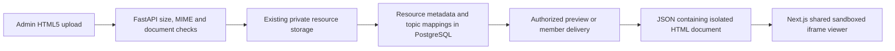

# Interactive HTML5 media — 2026-10-09

Owner scope: upgrade Interactive alone to support application-owned HTML/HTML5. Image and Video source rules, MIME limits, classification, players and provider policies stay unchanged. This instruction supersedes the earlier prohibition on admin HTML uploads for Interactive only.

## Handoff position

Interactive HTML5 is implemented and verified in development. The real Gravity Lab resource has also been uploaded and mapped through the signed-in admin UI. It is an available **unpublished draft, version 2**, with one Grade 1 Gravity topic-wide link and eight direct subtopic links. The stored admin preview completed a 10 m fall. Publication and real signed-in learner delivery of this particular record have not been performed. B9 remains PARTIAL through B9.11; existing stage totals are unchanged.

## How it was built

The existing HTML/JavaScript simulation was retained as a document rather than rewritten as React or added as a new game engine. FLAME's existing upload, resource record, curriculum associations, publication and recommendation services were extended for the Interactive family only.



1. The Next.js admin editor provides one Interactive editor with adjacent Code (edit / paste) and Preview tabs, plus Upload HTML5 file. Uploading populates Code; the Preview tab opens the isolated viewer. The Interactive source dropdown and approved-URL creation option have been removed. Pasted code becomes a UTF-8 interactive.html file through the same upload API. The existing BFF forwards the authenticated, CSRF-protected upload.
2. FastAPI validates extension/MIME, UTF-8, the 2 MiB bound, complete document structure and supported elements/dependency attributes. It saves an opaque HTML object key and an owner-scoped upload record using existing storage.
3. Save draft attaches that upload to an Interactive resource. Existing version-checked mapping writes associate published topic/subtopic paths. No new database table, source field or migration was required.
4. Preview and member delivery read the document through a bounded local/private-cloud adapter. Member delivery reuses current publication, mapping, curriculum revision, suitability and resource-version checks. The HTML document is returned as JSON, never a browser-executable signed HTML URL.
5. `InteractiveExperience` renders the document through `srcDoc` with restrictive CSP and `sandbox="allow-scripts"`. It supplies loading/retry/Restart; closing the parent viewer unmounts the iframe. The simulation's DOM, state and scripts stay inside that frame.
6. Existing catalogue retrieval supplies eligible Interactive candidates. Explicit simulation/interactive/experiment requests receive a format preference and an accurate reason while preserving relevance, grade/language, saved history and selection limits. The experience opens only after a learner action.

See [API contracts](stage-1/api-contracts.md) and [resource policy](stage-9-resource-policy.md) for owning contracts. The packaged demonstration allowlist still exists separately; the new catalogue upload path does not require adding an experience ID to it.

## Implemented contract

- Admin Media → Interactive → Upload HTML5 file accepts one complete UTF-8 `.html`/`.htm` document, declared `text/html`, up to 2 MiB. Inline HTML/CSS/JavaScript, canvas/SVG and embedded data assets are supported. Multi-file projects/ZIP execution, server code and runtime external dependencies are not supported. Bulk catalogue bundles can contain the same validated HTML asset through the existing import coordinator.
- Storage uses the existing private uploaded-media source, ownership, version and mapping contracts. No schema migration or resource backfill. HTML uploads cannot be attached to Image, Video or kit image sources.
- Draft preview and authorized member delivery return JSON with `launch_mode: interactive`, `html_document`, `version`, empty `url`, and null `expires_at`. Existing scoped delivery checks current path/revision, suitability and resource version. Current publication/mapping/availability are rechecked before retrieving the document. Local/cloud documents are bounded when read; the cloud adapter downloads only from its configured private bucket without redirects.
- HTML receives a restrictive CSP and is rendered only with iframe `srcDoc`, `sandbox="allow-scripts"` and `referrerPolicy="no-referrer"`. No same-origin, form submission, popups, parent navigation, permissions or parent/session data are granted. Network connections, nested frames, workers, remote scripts/styles/fonts/media and object embeds are blocked. CSS/JS must be inline; image/font/media assets must be embedded. Validation rejects external dependency attributes, frames/objects/forms, base and meta refresh. This is isolation of executable admin content, not HTML sanitization or a promise that every document is accessible/correct.
- Raw member content and admin preview-content routes refuse HTML. HTML is never delivered as executable content or a signed browser URL on the application origin. The frontend sees JSON and places the document in the isolated frame.
- Uploaded HTML publication requires an accessibility note with keyboard instructions, plus the existing rights/availability checks. Existing external Interactive HTTPS links retain their previous approved-host, separate-page behaviour and publication contract.
- The shared Interactive component provides loading/error/retry and Restart. Closing the existing viewer unmounts the frame and stops its animation/scripts. Image/Video branches are unchanged. Explore reuses the scoped catalogue viewer. Existing open-event tracking is reused; experiment results/reflections remain in the iframe and are reset on restart/close.
- Recommendation selection recognizes explicit interactive/simulation/experiment requests and gives matching Interactive candidates a format preference and an accurate interactive reason. Concept, grade, language, path eligibility, one-primary/one-alternative limits, saved decisions and history remain. No extra model call, RAG or mastery computation.

## Fullscreen wide viewer — 9 October 2026

The shared Interactive viewer has a top-right Full screen/Restore compact icon in local/saved admin previews and learner viewers. It requests parent-owned native fullscreen and uses a viewport-sized fallback when unavailable. The owner's later instruction supersedes the initial automatic-rotation implementation: no orientation lock/unlock calls and no CSS rotation. The device orientation remains under user control.

Fullscreen keeps an upright wide HTML canvas, at least as wide as the viewport's longer dimension. In portrait, the canvas scrolls horizontally while the toolbar and restore button stay within the visible screen. Manually rotating the phone to landscape lets the wide canvas fit the display. Restore/browser exit and unmount clean up fullscreen/scroll state. Escape restores the compact viewer before closing its resource dialog. Toggling retains the same iframe and experiment state; Restart intentionally resets it.

Sandbox permissions remain `allow-scripts` only; no fullscreen/orientation permissions are granted to the uploaded document. Styling is scoped to `components/ui/interactive-experience.module.css`; Image/Video remain unchanged. Browser tests cover native/fallback fullscreen, no orientation API calls, upright portrait layout, wide canvas/horizontal scrolling, visible restore controls, manual landscape viewport resizing, retained state and cleanup. Actual Android/iOS fullscreen, safe-area and assistive-device acceptance remains B9.11/B10. No backend/schema/catalogue/publication change.

## Author and administrator workflow

1. Export or prepare a complete self-contained HTML5 file. Remove platform SDKs and package external dependencies locally; relative assets and CDN libraries cannot run in this viewer.
2. Add Media → Interactive → Upload HTML5 file. Review the local sandbox preview, title/description, rights and keyboard/accessibility notes. Save draft and review saved Preview.
3. Add concept/synonym, grade/language and demonstrate/practise metadata as appropriate; map only suitable published topic/subtopic paths.
4. Publish explicitly. A published resource without valid mappings has no learner placement. Learners open it from Explore → Interactive or a relevant optional recommendation card.

The supplied Canva Gravity Lab was prepared as `work/gravity-lab-html5.html`: removed Canva bootstrap/SDK/CDN/font references, packaged its utility CSS, retained its original physics/chart/reflection logic and restored the missing `pause-label`/`resume-label` IDs referenced by its script. Scene ResizeObserver/animation-frame initialization keeps the ball's position correct after iframe/modal/mobile layout. The prepared file has now been uploaded as the draft below. Grade/content/rights review remains the administrator's responsibility.

## Live resource and mappings

Resource: **Gravity Lab — Interactive**, HTML5, Grade 1, English, available, draft v2. Recommendation concepts cover gravity, falling objects, mass, gravitational force and acceleration; purposes are demonstrate/practise. The admin supplied rights/source and keyboard notes. This records entered metadata, not independent educator or legal acceptance.

Path: **FlipLecture → Grade 1 → Science → Gravity (Forces & Motion) → Gravity**; the stored path also includes the same-named Category, hidden from learners. Nine saved associations:

- Gravity, topic-wide (covers all current and future subtopics).
- Everyday Effects of Gravity.
- Gravity Acts at a Distance.
- Gravity is a Force.
- Gravity Pulls Objects to Earth.
- New entry.
- Test.
- test 1.
- What is Gravity?

The owner requested all current subtopics, so existing placeholder-named nodes were included; no curriculum nodes were renamed or removed. The saved mapping list and stored preview were verified in the real admin session. Existing Image/Video records and mappings were not edited. Proof: `work/gravity-resource-mappings.jpg`; implementation browser screenshots: `work/interactive-desktop.png` and `work/interactive-mobile.png`.

## Current local runtime

Frontend: `http://localhost:3000`. Its ignored `.env.local` uses `FLAME_API_URL=http://127.0.0.1:8001`. Current FastAPI is running on port 8001 with reload. The old non-reloading process on 8000 was left running and still has the earlier HTML-upload rules; it is not the current frontend upstream. Readiness and authenticated upload/draft/mapping/preview succeeded after switching the upstream. This supersedes earlier port-8000 handoff instructions for this local session. No credentials were copied into documentation.

## Files

Backend: `resources/interactive.py`, `validation.py`, `storage.py`, `router.py`, `member_router.py`, `service.py`, `core/errors.py`; interactive-request branches in `recommendations/selection.py`. Frontend: `components/ui/interactive-experience.tsx`, `features/curriculum/resource-panel.tsx`, `resource-library-ui.tsx`, `features/learning/catalogue-recommendations.tsx`. Checks: `tests/test_interactive_media.py`, updated HTML declaration expectation in `test_b9_resources.py`, and `web/tests/interactive-browser.cjs`.

## Verification and limits

Focused backend upload/type/isolation and rollback-only lifecycle: 10 checks passed with B9/media-family regressions; final three Interactive checks and one additional private-cloud boundary check passed. Broader backend run: 54 passed; two legacy `test_resource_library.py` cases still expect GIF upload classification `animation`, which the existing October media-family migration changed to `video`. No Image/Video behaviour was changed to satisfy those stale expectations. Existing 17 frontend unit tests and final production build/TypeScript passed. The final Interactive browser suite passed Image preview, native Video play/pause, upload/local and saved preview, scoped Explore viewer, completed Gravity fall, sandbox parent/storage isolation, Restart, cleanup, mobile scene geometry and Escape. Desktop/mobile screenshots were inspected. Larger legacy media browser suites encountered generated native-video fixture failures/timeouts and are not claimed as passing. See STAGES-STEPS.md for final evidence and limitations.

The initial implementation checks made no real catalogue changes. The subsequent owner-authorized live admin upload created the single Gravity Lab draft and its nine mappings. No publication, migration, deployment, paid model call, Supabase bucket provisioning, or physical-device/educator acceptance occurred. B9.11/B10 and existing release gates remain open. Live cloud HTML delivery still needs verification against the configured private bucket; local rollback-only/API and fixture-browser evidence do not establish that gate.

## Reproduce the checks

Run from `development/apps/flame-api` in PowerShell. The database opt-in test uses the existing development configuration with rollback-only fixtures; it does not publish the real Gravity record.

```powershell
$env:FLAME_RUN_DB_TESTS='1'
.venv/Scripts/python.exe -m pytest tests/test_interactive_media.py tests/test_b9_resources.py tests/test_media_families.py -q
```

Run from `development/apps/web`:

```powershell
npm run typecheck
npm run test:unit
npm run build
node tests/interactive-browser.cjs
```

The browser harness starts its own fixture API and production frontend on port 3135. It uses the prepared `E:/FLAME/work/gravity-lab-html5.html`, the repository's browser-test Playwright installation and Edge; it does not mutate the real catalogue. Keep build and browser startup sequential. The broader legacy GIF assertions and generated-video browser-fixture failures remain documented gaps, not passing release evidence.

## Remaining stage handoff

1. On an explicit publication instruction, review the draft's rights, content, Grade 1 suitability and keyboard notes, then publish through the version-checked admin flow. Mapping alone does not publish.
2. Verify this real published resource from a signed-in learner at the Gravity topic and representative subtopics, including reopening, Restart, withdrawal and changed-version recovery. Fixture-browser coverage already passes but does not replace this live-record check.
3. Verify bounded HTML upload/preview/member delivery against the deployed private Supabase bucket. HTML JSON delivery has no signed-URL expiry; existing Image/Video expiry checks still belong to B9.11.
4. Complete physical-device, keyboard/screen-reader and educator review, and resolve the recorded legacy regression harness gaps before release acceptance. Close B9.11/B10 only with their full required evidence.

Operational reversal for a later published lab is the existing Unpublish action; retain its file and associations for review. This handoff does not authorize deletion, schema downgrade or publication.


### Interactive HTML source editor — 2026-10-09

Added Paste / edit HTML5 code as an Interactive-only media source choice in Add/Edit. A labelled monospace textarea accepts a complete single document, shows UTF-8 byte size against 2 MiB, and provides explicit isolated Preview HTML. Existing uploaded Interactive records load their saved JSON preview document for source editing; loading failures have Retry. Typing creates a text/html interactive.html File and uses existing authenticated upload, storage, creation-reference, version-checked draft save and publication APIs. Metadata-only edits keep existing media. Edits preserve source and uploaded references after failures/latest-version review; source changes invalidate the prior upload reference. Published source stays read-only until explicitly unpublished. Blank/oversized paste is blocked before upload; server document validation remains authoritative. No ZIP/multi-file support, schema/API change or extra publication behaviour.

Changed source: new html-source-editor.tsx, resource-panel.tsx, admin.css and new tests/html-editor-browser.cjs. Production build/TypeScript passed. Focused browser tests passed pasted creation/explicit sandbox preview, one creation under double-click, saved source loading, metadata-only retention, replacement and stale-version recovery preserving code, upload reuse, invalid HTML/oversize handling, publication protection and 390px layout. Existing interactive-browser suite also passed HTML file upload, stored admin preview, scoped Explore delivery, original Image/Video checks, simulation/fullscreen/restart/isolation/mobile/Escape. Narrow screenshot inspected: work/html-source-editor.png. Testing used isolated mock resources; no live catalogue writes or tracker status/count changes.


### Unified Interactive upload, source and preview — 2026-10-09

Owner combined the separate Interactive upload/paste sources. Interactive now has no media-source dropdown or approved HTTPS URL creation field. One editor presents adjacent Code (edit / paste) and Preview tabs plus Upload HTML5 file. A bounded UTF-8 file read populates Code without a server upload; Preview renders current code only on explicit tab selection. The instructor can edit uploaded code and save through the existing file APIs. Original uploaded filename is retained during editing. Invalid extension/type, oversized, blank, unreadable or invalid UTF-8 files retain previous code. Reading blocks Save; unmount invalidates late file reads. Keyboard tab navigation and responsive layout are included. Existing saved external Interactive records/API support remain compatible; no new external link can be entered in this form. Image/Video source options are unchanged.

Production build/TypeScript, expanded html-editor-browser and updated interactive-browser suites passed. Added coverage for absence of Interactive source/URL inputs, upload populating Code without an upload request, invalid file/UTF-8 preservation, Preview/Code keyboard switching and existing draft/retry/version/publication controls. Original HTML upload, saved admin and member/Explore previews, simulation, isolation, fullscreen, Image/Video and narrow layout regressions passed. The first full-suite attempt used a raw CRLF textarea equality check and timed out; corrected the test for native textarea LF normalization and the rerun passed without product changes. Screenshot inspected: work/html-source-editor.png. No backend/schema or live resource mutation; tracker totals/statuses unchanged.
